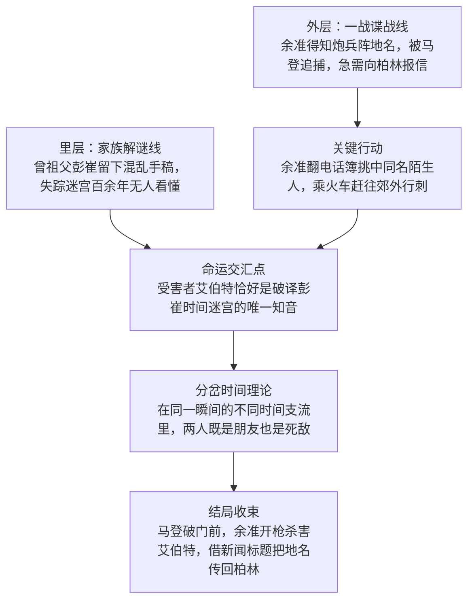

**标题：**
**博尔赫斯《小径分岔的花园》精读：一战间谍为了向柏林传递情报，枪杀了一位素不相识的汉学家**

***

设想你在翻看一份第一次世界大战期间的英国报纸，社会版面上刊登着一条摸不着头脑的凶案新闻：一名旅居英国的华人英语教授，突然乘火车跑到偏僻郊区，开枪打死了一位德高望重的汉学家，既不图财也不逃跑，当场束手就擒。

单看这条新闻，任谁都会觉得这是一起毫无缘由的荒唐凶案。可把阿根廷作家博尔赫斯这篇写于 1941 年的短篇读完，你才会惊觉，这则凶杀新闻本身就是一条发往柏林的绝密军事情报。

更令人拍案的是，博尔赫斯在这场不到一小时的暗杀行动里，还严丝合缝地塞进了一座关于平行时间与无限宇宙的迷宫。

---

### 一、表面是一场四十分钟的暗杀倒计时：通俗谍战壳怎么稳住烧脑哲学？

故事发生在 1916 年的一战期间。主角余准是一名在英国教书的中国人，暗地里替德国充当间谍——他效忠德国倒没什么家国情怀，仅仅是想向那个瞧不起东方人的德国上司证明自己的能力。

危机在小说开篇就拉满了警报：余准的同伴刚被英国反间谍军官马登抓获，马登很快就会顺藤摸瓜找上门来。余准手里掌握着一条至关重要的情报——英军设在法国前线某处的新炮兵阵地名称，可此时电话和电报都已被严密监控，他必须在不到一个小时的逃亡时间里，把这个地名传回柏林。

绝望之中，余准翻开电话簿，突然在陌生人名单里盯住了一个名字。他立刻揣上手枪出门，赶往火车站买票奔向伦敦郊外，而死敌马登也紧跟着追上了下一班火车。

博尔赫斯在这里展现出极老辣的叙事手艺：他没有一上来就跟读者大谈枯燥的时间哲学，而是先用一套极紧绷的谍战逃亡戏套住读者。有了追兵在后、时间流逝的倒计时压力，后面发生的一切才让人挪不开眼。

---

### 二、推开书房门后，故事突然拐进另一条时空线

下了火车后，余准向站台上的小孩打听去往那位陌生人住所的路。小孩随口叮嘱了一句古怪的走法：一路顺着岔路口往左拐就行——这正是中国古代走迷宫的传统诀窍。

沿着蜿蜒小路走进一座安静的庭院，迎接余准的是一位名叫斯蒂芬·艾伯特的英国汉学家。接下来发生了一件概率近乎奇迹的巧合：艾伯特并不知道眼前这位访客是来杀自己的，他反而兴冲冲地告诉余准，自己花了几十年时间，终于破译了余准的曾祖父彭崔留下的千古谜题。

原来，余准的曾祖父彭崔曾是一位权倾一方的中国高官，晚年却辞官归隐，立志要写一部奇书并建造一座无人能走出的迷宫。十三年后彭崔遭人刺杀，只留下一部自相矛盾、乱七八糟的手稿，世人却始终找不到那座传说中的迷宫在哪里。

艾伯特在书房里揭开了谜底：彭崔留下的那部混乱小说与那座失踪的迷宫，根本就是同一件东西。按照常规的写小说习惯，主角面临两条岔路时只能选一条往下走；可彭崔在书里打破了时间规律，让主角在每一个选择面前同时踏上所有分岔路口，从而衍生出无数条彼此平行、时而交汇的时间线。

下面这张结构图，能帮你一眼看清两条原本毫无关联的线索，是如何在艾伯特的书房里撞到一起的：

艾伯特微笑着对余准解释道，在这座以时间为原料的迷宫里，未来有无数种分支——在某一条时间线里，余准或许会以朋友的身份走进这座院子；而在另一条时间线里，他也许会以敌人的身份来访。

---

### 三、那声致命的枪响，把整座迷宫扣成了严密的闭环

就在两位素未谋面的知音畅谈家族手稿的时刻，院子外面的碎石路上响起了追兵马登急促的脚步声。时间彻底耗尽了。

余准借口想再看一眼曾祖父的亲笔信，趁着艾伯特背过身去的瞬间，在心里默念了一句对不起，随后掏出手枪对着这位汉学家的后背扣动了扳机。赶到的马登冲进书房将他当场逮捕，法庭随后判处他绞刑。

直到故事的最后两行，所有谜团才瞬间串联起来：原来英国人在法国隐藏炮兵阵地的那个城市，名字就叫**艾伯特**。

余准之所以在伦敦街头绝望地翻找电话簿，就是为了找一个和那个法国城市同姓同名的无辜英国人。他很清楚，只要自己在英国枪杀了一位名叫艾伯特的知名学者，第二天的伦敦报纸就一定会把凶案消息登在头版上；而远在柏林的德国情报头子只要读到这份报纸，立刻就能破译出被轰炸目标的准确地名。

情报顺利送达了，英军阵地随后遭到了轰炸。可被关在死牢里的余准在回忆起这一天时，心里没有半点胜利的喜悦，只剩下无边无际的忏悔——因为在亿万条分岔的时间线里，他偏偏走进了那条必须亲手杀掉家族唯一知音的残酷支流。

---

### 四、藏在迷宫底下的，是一套极高级的跨类型组装法

重读完《小径分岔的花园》，最让人震撼的不仅是平行宇宙的超前脑洞，更是博尔赫斯把两种完全相反的题材严丝合缝拧在一起的本事。

如果在小说里干巴巴地讲一通时间分岔哲学，绝大多数读者撑不过三页就会觉得枯燥；博尔赫斯偏偏找来了一个最通俗易懂的特工逃亡与密码暗杀外壳，用马登追捕的紧迫感拽着读者一路狂奔，顺理成章地把硬核的哲学概念送进了读者脑子里。

更难得的是结尾那份反爽文的情绪处理。普通谍战片写特工用报纸暗杀传出绝密情报，结尾往往是一场聪明的胜利；可博尔赫斯偏偏让受害者成为主角祖先最懂行的知音，让主角每回忆一次自己的智谋，就得再承受一次亲手毁掉珍宝的刺痛。

当一个故事同时具备了“智力上的严密闭环”与“情感上的无解遗憾”，它留在读者心里的重量，就远远超过了一场普通烧脑谜题的范畴。

