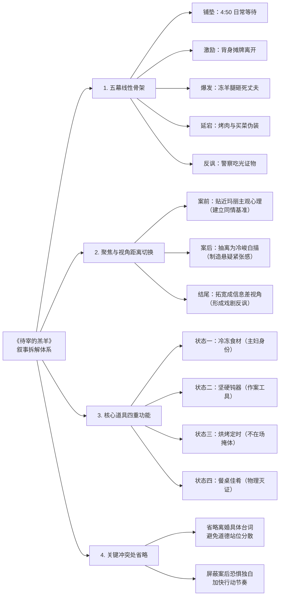

# 拆解《待宰的羔羊》：短篇小说如何用一根羊腿完成结构闭环与视角操控

1953年，英国作家罗尔德·达尔在《哈泼斯杂志》发表了短篇小说《待宰的羔羊》（*Lamb to the Slaughter*）。这篇小说不到四千字，讲的是一名怀有身孕的家庭主妇杀死警察丈夫、随后巧妙销毁罪证的故事。

普通犯罪故事往往让读者站在侦探一边期盼真相大白，这篇小说却让无数读者在结尾处站在了凶手这一边。下面按小说原本的**五段式线性结构**拆开来看，就算你完全没读过原著，也能顺着节奏看懂它的精妙之处。

---

### 一、 按结构拆解故事全貌

#### 1. 开端铺垫：周四傍晚的四点五十分
客厅里温暖整洁，台灯亮着，边桌上备好了冰块和苏打水。怀孕六个月的玛丽·马洛尼坐在椅子上安静地缝衣服，距离丈夫帕特里克下班还有十分钟。

帕特里克是一名警官，平时话很少，玛丽向来极度顺从，只要守在他身边就觉得踏实。按每周四的惯例，夫妻俩晚上都会出门吃饭。四点五十分整，帕特里克准时进门，玛丽接过他的大衣，照例为他调了一杯浓烈的威士忌，给自己倒了一杯很淡的酒。

> **▶ 结构定位：** 确立**第三人称限知视角**，用大量低冲突、高顺从度的日常细节把读者绑定在玛丽的主观感受里，建立后续的同情基准。

#### 2. 激励事件：窗前五分钟的冷漠摊牌
今天的帕特里克反常地沉默。他一口气灌完杯子里的酒，起身自己又倒了满满一杯，拒绝了玛丽帮忙。玛丽察觉到异样，小心翼翼地提议今天太累就别出门了，家里冰柜里有肉和奶酪，可以做一顿晚饭。

帕特里克背对着她站在窗前，声音冷硬地让她坐下，接着开口说了一件事。小说略去了他具体说了什么，只交代这段话大概持续了四五分钟，玛丽坐在原地一动不动，惊恐地盯着他。帕特里克明确表达了自己要离开的意思，同时答应会给一笔生活费照顾她，只要求她保持冷静，别闹出动静影响自己的警察前程。说完，他转过身再次扔下一句：

> “看在上帝的份上，别给我做晚饭，我要出门了。”

> **▶ 结构定位：** 运用**叙事省略**技巧。作者直接略去争吵细节，避免读者陷入“夫妻谁对谁错”的伦理拉扯，把全部压力聚拢在玛丽僵硬的反应上。

#### 3. 危机爆发：地下室拎出的冻羊腿
玛丽像丢了魂一样站起身，机械地走向地下室，打开冰柜，伸手拎出了一根用纸包着的冻羊腿。她撕掉包装纸，拎着羊腿走回客厅。

帕特里克依然背对着她站在窗边。玛丽走上前，双手高高举起那根冻得像铁块一样的羊腿，照着他的后脑勺猛砸下去。帕特里克倒在地毯上，顺带撞翻了一张小桌子，当场断了气。

> **▶ 结构定位：** **身份转化节点**。平平无奇的晚餐食材在几秒内转变为凶器，前面铺垫的委屈情绪在此刻瞬间爆发。

#### 4. 动作延宕：烤箱、镜子与街角杂货店
尸体躺在脚下，玛丽的脑子瞬间清醒过来。她清楚警察妻子杀害警官会面临怎样的绞刑，更想到了自己肚子里六个月大的孩子。

她拎起羊腿走进厨房，打开烤箱把羊腿放进去烤上。随后她走回卧室的镜子前，反复练习微笑的表情，并试着发出自然轻快的声音：

> “山姆，你好，给我拿点土豆和豌豆。”

练习妥当后，她穿上大衣出门走到街角的杂货店，和熟悉的店员山姆愉快地聊起天，买了土豆、一罐豌豆和一块帕特里克爱吃的芝士蛋糕，顺口解释说丈夫太累了，两人决定在家吃晚饭。推开家门回到客厅的那一刻，玛丽看到地上的尸体，真实而崩溃的哭声瞬间涌了出来——她拨通了报警电话。

> **▶ 结构定位：** **视角降温与延宕**。案发后作者抽掉了玛丽的内心独白，全部改用冷冰冰的动作白描，借日常秩序制造悬念（她到底能不能瞒过去？）。

#### 5. 高潮与反讽：餐桌上的秘密笑声
帕特里克的同事们很快涌进屋子。带队的警官杰克·诺南是夫妻俩的老熟人，他一边安抚玛丽，一边带人展开地毯式搜查。忙活了整整几个小时后，警方根据头骨碎裂的程度认定：凶手使用了一根极其沉重的金属钝器（比如大号扳手），作案后把凶器带走了。

到了晚上九点多，搜索毫无进展。玛丽抹着眼泪请求杰克帮自己倒一杯威士忌，接着恳求这群疲惫不堪、还没吃晚饭的警察帮个忙——把烤箱里已经烤熟的那只羊腿吃掉，免得白白浪费。警察们推辞了一番，最终围坐在厨房的餐桌旁大口吃起了烤羊肉。饭桌上，一名警官嘴里嚼着肉，还在感慨：

> “搞不好这东西现在就在咱们的眼皮底下呢。”

隔壁房间里，玛丽·马洛尼听见这句话，独自捂着嘴笑出了声。

> **▶ 结构定位：** **戏剧反讽 + 结构闭环**。侦探亲手吃掉凶器，读者与凶手共享真相、警察蒙在鼓里，全篇在冷峻的笑声中收拢。

---

### 二、 结构拆解与叙事机制分析

把上面五个阶段背后的“结构骨架、视角操控、道具复用、留白策略”拆开，全局结构可以用下面这张横向导图来呈现：

具体到专业写作技法，这篇小说最值得拆解的是以下三个核心机制：

#### 1. 聚焦控制与“视角距离”的三次切换
全篇采用**第三人称有限视角（Focalization）**，镜头始终锁在玛丽·马洛尼一个人身上，但达尔在不同阶段精准调整了相机和角色的距离：
* **案发前（贴近心理）：** 写玛丽算着时间等丈夫、关注丈夫的疲惫、享受安静的陪伴，镜头贴在她的主观感受上。这一步在叙事学上叫**“同情基准建立”**——让读者先在潜意识里认同她的善良与卑微。
* **行凶后（拉远镜头）：** 砸死帕特里克之后，达尔立刻停止描写玛丽的内心独白，全部改用**行为白描**（放进烤箱、对镜子练微笑、买土豆和芝士蛋糕）。如果此时大段描写她“有多害怕、多后悔”，紧张感就会泄掉；恰恰因为只写冷冰冰的动作，读者的注意力全部被抓进“她能不能瞒过去”的悬念里。
* **餐桌戏（拉开全知反讽）：** 最后一幕警察在厨房说话、玛丽在隔壁发笑，视角微微拓宽，让读者同时握有“警察的盲区”和“玛丽的秘密”两份信息，制造出极强的**戏剧反讽（Dramatic Irony）**。

#### 2. 关键冲突处的“省略技法”（叙事加速与重心控制）
小说中最重要的危机节点——帕特里克提出离婚——达尔连一句具体的解释台词都没有写，直接用一句“他说了大概四五分钟”带过。

这一笔省略在结构上起到了两个关键作用：
* **避免主题跑偏：** 一旦把离婚理由写具体（比如出轨、性格不合或金钱纠纷），读者的注意力就会分流去评判“谁对谁错”，小说的悬疑张力会被家长里短冲淡。
* **控制心理节奏：** 跳过具体台词，重点只落在“她一动不动地坐着”、“她去地下室拿羊腿”，这种**省略原因、放大反应**的写法，把一段俗套的家庭伦理冲突，直接压缩成了一场极具冲击力的心理突袭。

#### 3. 核心道具的“叙事经济性”（一物四用的结构闭环）
传统凶杀叙事通常会把“作案凶器”和“销毁证据”拆成两条线处理（比如用扳手杀人，再去河边扔扳手），中间往往需要塞入大量巧合或惊险桥段。

达尔在《待宰的羔羊》里展示了短篇结构极高的压缩率，把四个截然不同的功能全部叠在了**一根羊腿**上：
1. **日常背景物：** 冰柜里普通的晚餐食材，证明玛丽的家庭主妇身份；
2. **临时凶器：** 冷冻后的物理硬度足以一击致命；
3. **不在场证明道具：** 烘烤羊腿的时间正好覆盖她去杂货店买配菜的时段；
4. **灭证与反讽工具：** 警察亲手吃掉罪证，并在咀嚼过程中说出“凶器就在眼皮底下”。

全篇没有引入任何多余人物，也没有依赖“突然停电”“警察临时有事撤离”之类的外部巧合，完全依靠这件道具自身物理形态的改变（冻硬→烤熟→被吃掉）推动结局闭合。

---

### 三、 可迁移的高价值方法论（阅读与写作通用）

拆解这篇小说，最终要落到可以复用的规律上。从这篇里可以提炼出三条直接能用的模型：

1. **改变读者道德站位的“先锚定、后越界”公式**
   * **原理：** 当主角要做出违背常理或道德的举动时，提前用高频、具体、低攻击性的日常细节把读者锚定在主角的视角里，再用一个不对等的伤害打破平衡。读者在心理上把“过错方”标记出来之后，就会自动站在主角一边。
   * **应用：** 写人物黑化、复仇或反抗转折时，决定读者买不买账的关键，在于前面是否积累了足够具体且真实的微小委屈。

2. **短篇结构优化原则：用“道具变形”替代“新增情节”**
   * **原理：** 短篇小说经不起冗长的善后逻辑。在构思转折或破局时，优先检查开篇已经摆在台面上的常规元素，让它通过状态改变（比如生肉变熟肉、工具变障碍）去承担后续的剧情功能，远比结尾临时引入新线索来得严密。
   * **应用：** 自己写故事觉得中后段松散、全靠巧合硬凑时，试着删掉后半段新加的角色或道具，逼自己用前半段已经出现过的东西去解决问题。

3. **强冲突场面的留白处理：删台词、留动作**
   * **原理：** 情绪越剧烈、打击越沉重的场面，长篇大论的吵架或内心独白越容易显得假。用外部时间跨度的略写搭配精确的身体动作（站姿、转身、开冰箱、照镜子），留给读者的想象空间比直白解释更有压迫感。

