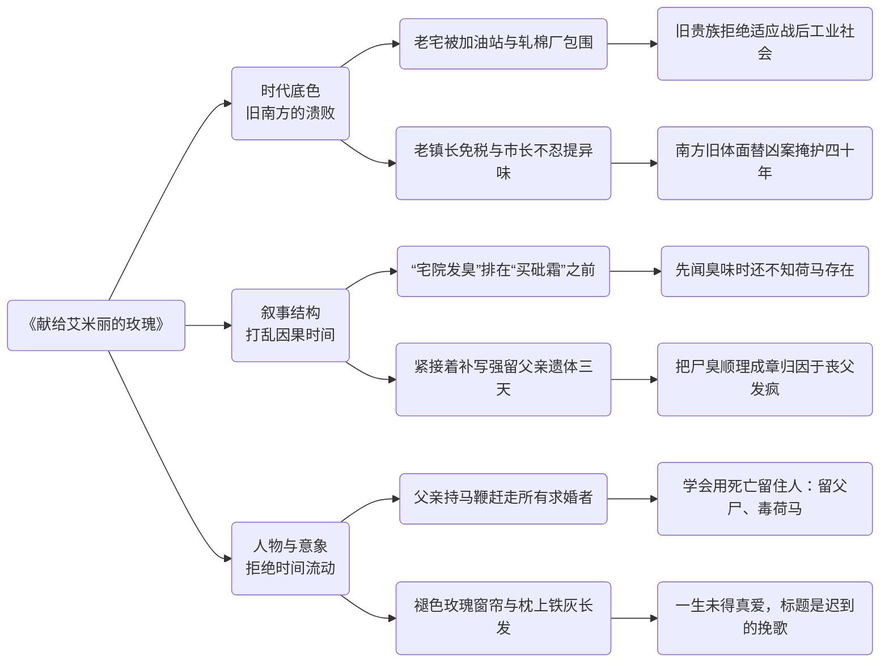

# 《献给艾米丽的玫瑰》：一座老宅里的四十年畸恋，与战败后不肯退场的旧南方

1930年4月，美国作家威廉·福克纳在《论坛》杂志发表了短篇小说《献给艾米丽的玫瑰》（*A Rose for Emily*）。这篇不到五千字的小说，讲的是一名受尽父亲压抑的南方没落贵族小姐，在唯一的情人打算离开时将其毒杀，并守着尸体在老宅里闭门生活了四十年的故事。

全篇的故事线顺着四段往事展开：

* **葬礼与老宅：** 南方小镇杰斐逊上最后一位没落贵族艾米丽·格里尔森小姐去世了，全镇人借着葬礼涌进她那栋十年没让外人踏足的老宅。
* **生前怪癖：** 活着时的艾米丽古怪又傲慢。镇议员上门催税，她拿早已死去十年的老镇长挡回去；父亲去世时她坚持说人还活着，硬把遗体留在家里三天；三十年前宅院周围传出恶臭，老市长顾及贵族体面不敢当面过问，只派人半夜偷偷去墙根撒石灰。
* **消失的男友：** 父亲死后的夏天，北方修路工头荷马·巴伦带她坐马车兜风，私下却宣称不想结婚。艾米丽随即去药店买下砒霜，转头又置办了男装和刻有荷马姓名首字母的银质洗漱具。某个黄昏，有人看见荷马走进了她家的厨房后门，从此再没出来过。
* **四十年的门后：** 此后艾米丽彻底闭门独居，活到七十四岁去世。葬礼过后，镇民们撞开楼上封锁了四十年的房间：褪色的玫瑰色窗帘下摆着男士衣物，床上躺着一具早已风化成骨架的男人尸体，而在他身旁的另一只枕头上，印着一个头颅凹痕，上面留着一根长长的铁灰色头发。

福克纳写这桩跨越半个世纪的畸恋，把旧南方的时代挽歌、错位的时间线与人物悲剧严密地拧在了一起：

---

### 一、 浓烈的时代气息：被加油站包围的没落贵族，和不肯翻篇的旧南方

想看懂艾米丽为什么执拗了一辈子，必须先看清故事发生的时间跨度：从十九世纪六十年代美国南北战争前后，一直延续到二十世纪三十年代。这是旧南方种植园秩序彻底瓦解、现代工业文明强势接管的七十年。

福克纳在小说开篇就把这种新旧时代撞在一起的别扭劲儿写出来了。艾米丽居住的那栋大宅建于十九世纪七十年代，曾经漆得雪白，装点着繁复的圆顶和雕花阳台，坐落在全镇最高贵的街道上。可到了她去世时，那条街早就被修车厂和轧棉厂吞没，**只有她这栋屋子固执而衰败地矗立在棉花马车和现代加油站油泵中间**，成了镇民眼里的“眼中钉”。而她最终下葬的墓地里，并排躺着当年杰斐逊战役中阵亡的北方联邦军和南方邦联士兵。

小说里的几乎每一个重要人物，身上都带着鲜明的时代印记：

* **1894年的老镇长沙多里斯上校：** 这位曾经的南方邦联军官，当年颁布过一条带有强烈种族等级色彩的地方法规，规定“黑人女性上街必须系围裙”。为了照顾格里尔森家的贵族尊严，他在1894年编了一个“镇上欠她父亲钱”的体面借口，永久免除了艾米丽的税款。老宅里那个伺候到最后、等主人一咽气就从后门头也不回走掉的老黑人仆人托比，同样是战后残存的旧主仆秩序缩影。
* **新一代镇议员与老市长：** 等到信奉商业契约的新一代人当上镇议员，他们按现代规矩给艾米丽寄去了税单。坐在满屋灰尘里的艾米丽依然只认死去快十年的沙多里斯，用乌木手杖把现代规则挡在门外。而三十年前宅院发臭时，八十岁的老市长史蒂文斯法官死活不肯当面去问责，只因“没法当着一位体面女士的面说她身上有臭味”。正是这种对旧南方绅士体面的集体维护，替一具尸体打了四十年的掩护。
* **北方工头荷马·巴伦的侵入：** 荷马的北方身份非常关键。他是跟着铺路公司南下修筑现代人行道的工头，肤色黝黑、嗓门洪亮，驾着马车在小镇上招摇，整天和男人们在俱乐部里混在一起。对于战败后死守血统傲慢的南方贵族而言，这样一个带着工业机器闯进来的北方佬，原本是最受鄙视的粗俗入侵者。

艾米丽爱上他，又在对方拒绝结婚时用砒霜留下他，个人情欲的崩溃和阶层尊严的崩塌叠在了一起。男人们去参加她的葬礼时，福克纳用了一个词形容众人的心情：**仿佛在悼念“一座倒下的纪念碑”**。艾米丽抗拒交税、抗拒承认父亲死去、拒绝让情人走出大门，和战败后的旧南方拒绝承认种植园时代已经结束，用的是同一种固执。

---

### 二、 叙事结构：靠一张“错位时间表”把谋杀藏在光天化日之下

为了匹配一座被时间遗忘的城镇，福克纳把全篇拆成五段，故意打乱事件发生的真实顺序，用小镇居民集体回忆的口吻来回跳跃。

| 小说阅读顺序 | 镇民看到的情节 | 对应的真实时间阶段 | 作者隐藏的意图 |
| :--- | :--- | :--- | :--- |
| **开篇** | 艾米丽去世办葬礼；晚年拒绝交税 | **终点（死后葬礼）** 与 **后期（晚年拒税）** | 先抛出神秘老宅与“纪念碑”意象，确立主角抗拒时间流动的性格 |
| **第一次回溯** | 宅院传出恶臭撒石灰；早年强留父尸三天 | **中期（荷马遇害后）** 与 **起点（父亲初丧）** | 把“尸臭”提前丢出来，紧接着讲她留父尸的偏执，用早年往事掩护当下的谋杀 |
| **第二次回溯** | 结识荷马·巴伦；听闻不婚后去买砒霜 | **前期（父丧后不久，准备作案）** | 把买毒药放在“男友不想结婚”之后，让读者误以为遭抛弃的她买砒霜是为了自杀 |
| **中后段推进** | 置办男装与银器；荷马进门后消失四十年 | **中期转折（行凶瞬间）** 至 **后期（独居终老）** | 借“我们”站在厨房门外的视角盲区，用四十年的闭门时间把秘密彻底捂住 |
| **尾声** | 葬礼后撬开楼上房门，见白骨与铁灰长发 | **终点（葬礼之后，真相揭晓）** | 只摆出“男尸骨架”和“属于晚年艾米丽的灰发”，逼读者自己倒回前文拼出全案 |

按正常的因果顺序，这件事根本藏不住：男友拒绝结婚，女主去买毒药，男友进屋失踪，接着屋子传出恶臭，读者看到一半就能猜出床上躺着谁。

福克纳通过**拆散“作案工具”和“腐烂结果”的邻近关系**避开了这个破绽。读者先听到“房子发臭、半夜撒石灰”时，荷马·巴伦这个名字压根还没出场；等到后面看见艾米丽去药店冷冰冰地说“我要买毒药”，前面撒石灰的事早已被中间穿插的父丧往事冲淡了。整篇没有隐瞒任何关键线索，全靠调换先后顺序把真相藏到了最后一行。

---

### 三、 人物塑造与意象：被马鞭定格的青春，和一朵迟到的玫瑰

抛开凶杀案的悬念不谈，艾米丽一生的悲剧根源，全写在镇民回忆里的一幅画面中：

> “她总是穿着白衣、苗条的身影站在背景里，而她父亲叉开双腿的剪影挡在前景里，背对着她，手里握着一根马鞭。”

父亲把所有上门求婚的青年全部赶走，把女儿当成维护家族纯洁的私有品锁在家里。等到她三十岁出头、父亲终于去世时，艾米丽已经错过了正常去爱和建立生活的年纪。她的人生早就被那根马鞭抽空了，唯一学会的占有方式就是“不让死去的人离开”。

她一生两次留住男人的做法，用的完全是同一种逻辑：
1. **父亲死时**，她守着遗体三天不肯交出去；
2. **荷马想走时**，她用砒霜留住了唯一属于自己的男人，把他变成了永远不会再离开的丈夫。

回头看结尾那间屋子的细节，所有意象全部扣在了一起：房间是按新婚洞房布置的，窗帘是“褪色的玫瑰色”，桌上摆着他俩的银器，而她在“婚姻”里陪着一具骷髅睡到头发变成铁灰色。

小说通篇没有出现过一朵真正的玫瑰，福克纳把标题定为《献给艾米丽的玫瑰》。艾米丽活着时只见过父亲的马鞭、死去的躯体和全镇人冷漠的窥探，作者只能在故事之外，替她献上这朵迟到的致意与挽歌。
