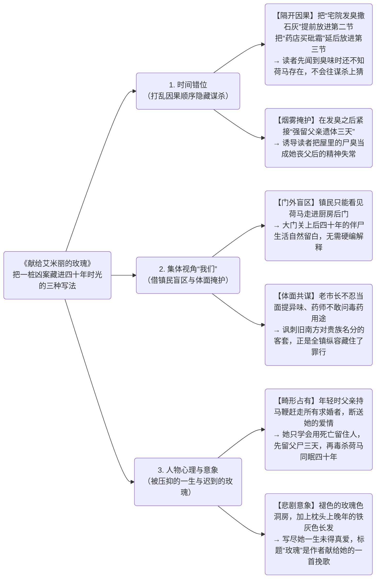

# 拆解《献给艾米丽的玫瑰》：时间错位、集体盲区与一座老宅里的畸恋

1930年，美国作家威廉·福克纳发表了短篇小说《献给艾米丽的玫瑰》（*A Rose for Emily*）。这篇不到五千字的小说，讲的是一名受尽父亲压抑的南方没落贵族小姐，在唯一的情人打算离开时将其毒杀，并守着尸体在老宅里闭门生活了四十年的故事。

为了方便没读过原著的朋友直接进入拆解，先用四个片段把事情的来龙去脉过一遍：

* **葬礼与老宅：** 南方小镇杰斐逊上最后一位没落贵族艾米丽·格里尔森小姐去世了，全镇人借着葬礼涌进她那栋十年没让外人踏足的老宅。
* **生前怪癖：** 活着时的艾米丽古怪又傲慢。镇议员上门催税，她拿早已死去十年的老镇长挡回去；父亲去世时她坚持说人还活着，硬把遗体留在家里三天；三十年前宅院周围传出恶臭，老市长顾及贵族体面不敢当面过问，只派人半夜偷偷去墙根撒石灰。
* **消失的男友：** 父亲死后的夏天，北方修路工头荷马·巴伦带她坐马车兜风，私下却宣称不想结婚。艾米丽随即去药店买下砒霜，转头又置办了男装和刻有荷马姓名首字母的银质洗漱具。某个黄昏，有人看见荷马走进了她家的厨房后门，从此再没出来过。
* **四十年的门后：** 此后艾米丽彻底闭门独居，活到七十四岁去世。葬礼过后，镇民们撞开楼上封锁了四十年的房间：褪色的玫瑰色窗帘下摆着男士衣物，床上躺着一具早已风化成骨架的男人尸体，而在他身旁的另一只枕头上，印着一个头颅凹痕，上面留着一根长长的铁灰色头发。

故事本身并不复杂，真正让这篇小说在文学史上反复被讨论的，是福克纳在**时间编排、叙事视角、人物心理**三处做出的精密设计。全篇的拆解脉络如下：

---

### 一、 叙事结构：靠一张“错位时间表”把谋杀藏在光天化日之下

如果按正常时间顺序把这件事写出来（男友拒绝结婚、女主买毒药、男友进屋失踪、屋子发臭），读者读到一半就能猜出床上躺着谁。福克纳把全篇拆成五节，故意把事件发生的时间和读者读到的顺序错开：

| 小说阅读顺序 | 镇民看到的情节 | 对应的真实时间阶段 | 作者隐藏的意图 |
| :--- | :--- | :--- | :--- |
| **第一节** | 艾米丽去世办葬礼；晚年拒绝交税 | **终点（死后葬礼）** 与 **后期（晚年拒税）** | 先抛出一栋外人十年没进过的神秘老宅，确立主角抗拒时间流动的固执性格 |
| **第二节** | 宅院传出恶臭撒石灰；早年强留父尸三天 | **中期（荷马遇害后）** 与 **起点（父亲初丧）** | 把“尸臭”提前丢出来，紧接着讲她留父尸的偏执，用早年往事掩护当下的谋杀 |
| **第三节** | 结识荷马·巴伦；听闻不婚后去买砒霜 | **前期（父丧后不久，准备作案）** | 把买毒药放在“男友不想结婚”之后，让读者误以为遭抛弃的她买砒霜是为了自杀 |
| **第四节** | 置办男装与银器；荷马进门后消失四十年 | **中期转折（行凶瞬间）** 至 **后期（独居终老）** | 借厨房后门切断外部视线，跳过室内细节，用四十年的闭门时间把秘密彻底捂住 |
| **第五节** | 葬礼后撬开楼上房门，见白骨与铁灰长发 | **终点（葬礼之后，真相揭晓）** | 只摆出“男尸骨架”和“属于晚年艾米丽的灰发”，逼读者自己倒回前四节拼出全案 |

把这张表摆出来就能看清福克纳的手法：**拆散“作案工具”和“腐烂结果”的邻近关系**。

读者在第二节看到“房子发臭、半夜撒石灰”时，荷马·巴伦这个名字压根还没出场；等到第三节看见艾米丽去药店冷冰冰地说“我要买毒药”，前面撒石灰的事早已被中间穿插的父丧往事冲淡了。悬疑感得以维持到最后一行，全靠这种不撒谎、只调换先后顺序的错位技巧。

---

### 二、 视角与社会讽刺：“我们”既是叙事滤镜，也是隐形共谋

整篇小说由一个含混的复数群体“我们”（杰斐逊镇的居民）来讲述。

这种群体视角在小说里承担了两重功能：

**第一，替封闭的主角制造天然盲区。** “我们”站在老宅的围墙之外，只能依靠马车兜风、药店购药、黄昏进门这些零碎的外部画面去猜测艾米丽的心思。只要大门一关，“我们”就成了瞎子。荷马死后那四十年里，艾米丽如何与尸体共处、头发如何一点点变灰，全因为叙述者站在门外而得以自然省略，不需要作者硬编解释。

**第二，借视角把矛头指向南方小镇的虚伪体面。** 艾米丽能把尸体在楼上藏四十年，离不开整个小镇的纵容：
* 邻居投诉她家发臭时，八十岁的老市长史蒂文斯法官说出一句极具时代特征的反问：“天哪，你叫我怎么当面跟一位女士说她身上有臭味？”
* 药剂师明知她买砒霜用途可疑，慑于格里尔森家族的旧日威望，还是乖乖包好递了出去，只在盒子上写下“灭鼠用”。

福克纳借着“我们”的口吻，把一桩猎奇凶杀案写成了对旧南方绅士体面的讽刺。正是所有人对贵族名分的敬畏与客套，替凶手筑起了四十年的保护墙。

---

### 三、 人物塑造与意象：被马鞭定格的青春，和一朵迟到的玫瑰

如果只停在“女人杀掉负心汉、伴尸四十年”，这篇小说就会流于三流恐怖故事。福克纳在第二节里只用了一个定格画面，就立住了艾米丽一生的悲剧根源。

小说写过镇民记忆里年轻时的艾米丽和她的父亲：“她总是穿着白衣、苗条的身影站在背景里，而她父亲叉开双腿的剪影挡在前景里，背对着她，手里握着一根马鞭。”

父亲把所有上门求婚的青年全部赶走，把女儿当成维护家族纯洁的私有品锁在家里。等到她三十岁出头、父亲终于去世时，艾米丽已经错过了正常去爱和建立生活的年纪。她的人生早就被那根马鞭抽空了，唯一学会的占有方式就是“不让死去的人离开”。

于是你会发现她一生的动作高度一致：
1. **父亲死时**，她守着遗体三天不肯交出去；
2. **荷马想走时**，她用砒霜留住了唯一属于自己的男人，把他变成了永远不会再离开的丈夫。

回头看结尾那间屋子的细节，所有意象全部扣在了一起：房间是按新婚洞房布置的，窗帘是“褪色的玫瑰色”，桌上摆着他俩的银器，而她在“婚姻”里陪着一具骷髅睡到头发变成铁灰色。

小说通篇没有出现过一朵真正的玫瑰，福克纳把标题定为《献给艾米丽的玫瑰》。这个在活着时只见过父亲的马鞭、死去的躯体和全镇人冷漠窥探的女人，作者在故事之外，替她献上了一朵迟到的致意与挽歌。
